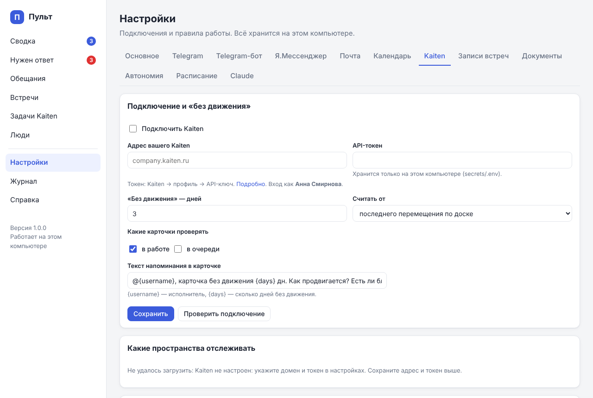

# Подключения

Всё настраивается в админке: http://localhost:8765 → **Настройки**. Пароли и токены
сохраняются только на этом компьютере (`secrets\.env`). После каждого подключения
нажимайте **«Проверить подключение»**.

Рекомендуемый порядок: Telegram-бот → Kaiten → Telegram → Пачка → почта (Яндекс, Gmail) → календарь →
записи встреч → документы → Яндекс Мессенджер (его готовит администратор, лучше
попросить заранее).

## Основное

Настройки → **Основное**: имя директора (Claude будет знать, чьи это обещания),
часовой пояс, рабочие часы и дни. В рабочее время Claude разбирает сообщения;
дайджесты и напоминания приходят только в рабочие дни.

## Telegram-бот

Через бота приходят сводки и итоги встреч, работают кнопки «Да/Нет». Ему же можно
писать вопросы и поручения или наговаривать их голосом.

1. В Telegram откройте **@BotFather** → `/newbot`.
2. Имя — например «PULSE Анны»; адрес — любой свободный, заканчивается на `bot`.
3. BotFather пришлёт **токен** вида `123456789:AAH…` — скопируйте.
4. Админка → Настройки → **Telegram-бот**: вставьте токен, отметьте «Бот включён», «Сохранить».
5. **Привязка:** нажмите «Открыть @… в Telegram» → «Запустить». Или отправьте боту
   `/start КОД` — код показан на этой же странице. Бот отвечает только тому, кто привязался.
6. «Отправить проверочное сообщение» — должно прийти в Telegram.

Тихие часы (по умолчанию 21:00–08:30): в это время приходит только срочное.

## Kaiten

1. В Kaiten: аватар → **Профиль** → **API-ключ** (ключи API) → создать → скопировать.
   Ключ работает от имени директора: карточки будут создаваться от её имени.
2. Админка → Настройки → **Kaiten**: адрес (`company.kaiten.ru`), токен, «Подключить Kaiten», «Сохранить».
3. **Какие пространства отслеживать** — отметьте пространства, задачи которых
   PULSE должен видеть и проверять на «без движения». «Сохранить пространства».
4. **Куда создавать карточки** — добавьте «направления»: название (например,
   «Операционка», «Продажи», «HR») → пространство → доска → колонка → дорожка.
   Claude выбирает направление по смыслу задачи; одно из них — по умолчанию.
5. **Без движения**: через сколько дней карточка считается зависшей (по умолчанию 3),
   считать от перемещения по доске или от любого изменения, какие состояния проверять
   («в работе» и/или «в очереди»), какие доски не проверять, текст напоминания.

Каждый день в 10:00 (меняется в «Расписании») бот присылает зависшие карточки
с кнопками **«Напомнить»** (комментарий в карточке с упоминанием исполнителя)
и **«Отложить»** (на 3 дня).

## Telegram

PULSE читает ваш аккаунт **только в отмеченных чатах** и ничего не пишет от вашего имени.

**1. Ключи приложения (один раз):**
1. Откройте https://my.telegram.org → введите номер телефона → код придёт в Telegram.
2. **API development tools** → заполните: App title `PULSE`, Short name `pulse`
   (латиница, 5–32 символа), Platform — Desktop → **Create application**.
3. Скопируйте **api_id** (число) и **api_hash** (32 символа).

Если my.telegram.org показывает «ERROR» — попробуйте другой браузер, отключите VPN
или придумайте другое короткое имя.

**2. Вход:** Настройки → **Telegram**: вставьте ключи → «Сохранить ключи» → номер
телефона → «Получить код» → код придёт **в приложение Telegram** (не по SMS) →
«Подтвердить». Если включена двухэтапная проверка — введите облачный пароль.

**3. Выбор чатов:** «↻ Обновить список» → у нужных чатов нажмите **✓** (читать);
**—** — не читать, **✕** — никогда. Выбор сохраняется сразу. Сверху — чаты, где писали
недавно; фильтры отбирают «Читаю / Не читаю / Никогда» и тип чата (личные, группы,
каналы, боты), есть сортировка по алфавиту. Для личных переписок можно не отмечать
каждую, а включить «Читать все личные переписки»; отдельные чаты пометьте ✕. Включите
«Читать Telegram» → «Сохранить».

Группа с темами (как «Отдел продаж» → «Итоги дня», «Отгрузки», «General») отмечается целиком:
PULSE читает все её темы и у каждого сообщения запоминает, из какой оно темы. Отдельные темы
выбрать нельзя.

В Telegram появится уведомление о новом входе «PULSE» — это нормально.
Отключить доступ можно в любой момент: Telegram → Настройки → Устройства, или
кнопкой «Выйти» в админке.

## Пачка

PULSE читает Пачку **вашим персональным токеном**: видит то же, что вы в Пачке, но берёт
**только отмеченные чаты** (и треды в них) и ничего не пишет от вашего имени.

**1. Токен.** Пачка → **Интеграции → API** → «Создать токен». Название — `PULSE`,
разрешения — только на чтение:

- `chats:read` — список чатов;
- `messages:read` — сообщения;
- `threads:read` — треды;
- `users:read` — имена отправителей.

Токен показывается один раз — скопируйте его сразу.

Если страницы «API» нет или кнопка недоступна — в вашем пространстве персональные токены
выпускают только администраторы (так в Пачке по умолчанию). Попросите администратора
(текст можно переслать):

> Разреши, пожалуйста, сотрудникам создавать персональные токены в Пачке: Настройки
> пространства → «Кто может создавать персональные токены» → «Все сотрудники». Нужно,
> чтобы мой рабочий пульт читал мои чаты (токен только на чтение).

**2. Подключение:** Настройки → **Пачка**: вставьте токен, отметьте «Читать Пачку» →
«Сохранить» → «Проверить подключение». Проверка покажет, под чьим именем вход и каких
разрешений не хватает; если у токена есть лишние права на запись — подскажет, что их
можно снять.

**3. Выбор чатов:** после сохранения появится список ваших чатов — у нужных нажмите **✓**.
Выбор сохраняется сразу. Есть поиск, фильтры «Читаю / Не читаю» и по типу (личные,
беседы, каналы, боты). Новые чаты появляются в списке сами; «↻ Обновить список» —
забрать их сейчас. При первом чтении чата PULSE берёт сообщения за последние 3 дня.

Отключить доступ — удалите токен в Пачке (Интеграции → API) или снимите «Читать Пачку».

## Яндекс Почта

1. В почте: **Все настройки → Почтовые программы** → включите «С сервера imap.yandex.ru
   по протоколу IMAP» и «Пароли приложений и OAuth-токены».
2. https://id.yandex.ru → **Безопасность → Пароли приложений** → создать пароль
   для **Почты**, имя «PULSE» → скопируйте (показывается один раз).
3. Админка → Настройки → **Почта**: адрес, пароль приложения, «Читать почту» →
   «Сохранить» → «Проверить».

«Отправленные» тоже читаются (можно выключить): так видно, что вы обещали в письмах.
Письма не помечаются прочитанными. Рассылки и уведомления отсекаются по списку
«не обращать внимания на отправителей».

В Яндекс 360 для бизнеса пароли приложений и IMAP может ограничивать
администратор организации — если не пускает, попросите разрешить.

## Gmail

Подключается вторым ящиком рядом с Яндекс Почтой — письма из обоих попадают в один разбор.

1. Включите двухэтапную аутентификацию: https://myaccount.google.com/signinoptions/twosv.
2. https://myaccount.google.com/apppasswords → название «PULSE» → **Создать** →
   скопируйте 16 букв (показываются один раз).
3. Админка → Настройки → **Почта** → блок **Gmail**: адрес, пароль приложения,
   «Читать Gmail» → «Сохранить» → «Проверить подключение».

По умолчанию читаются только **«Основные»** входящие — без «Промоакций», «Соцсетей»
и «Оповещений» (галочку можно снять) — и «Отправленные». Список «не обращать внимания
на отправителей» общий с Яндекс Почтой. IMAP в Gmail включён всегда, отдельно его
включать не нужно.

Если пункта «Пароли приложений» нет: не включена двухэтапная аутентификация, или
это рабочий аккаунт Google Workspace, где их запретил администратор.

## Яндекс Календарь

1. https://id.yandex.ru → **Безопасность → Пароли приложений** → создать пароль для
   **Календаря (CalDAV)**. Это отдельный пароль, не тот, что для почты.
2. Админка → Настройки → **Календарь**: логин (адрес почты), пароль, «Подключить» →
   «Сохранить» → «Проверить».

Новый пароль приложения иногда начинает работать не сразу (до 2–3 часов) — если
проверка не проходит, повторите позже.

Создание и отмена встреч — только через подтверждение. Проверьте один раз на тестовой
встрече, что приглашения доходят участникам: это зависит от настроек Яндекс 360.

## Google Календарь

Подключается в дополнение к Яндекс Календарю, **только для чтения**: встречи из Google
видны на главной, в «Календаре», в дайджестах и привязываются к записям встреч. Новые
встречи PULSE создаёт в Яндекс Календаре; отменить встречу из Google можно только в Google.

1. Google Календарь в браузере → ⚙ **Настройки** → слева в «Настройки моих календарей»
   выберите календарь → **«Интеграция календаря»**.
2. Скопируйте **«Секретный адрес в формате iCal»** (не публичный адрес).
3. Админка → Настройки → **Календарь** → блок **Google Календарь**: вставьте адрес
   (для нескольких календарей — по одному в строке), «Читать Google Календарь» →
   «Сохранить» → «Проверить подключение».

Секретный адрес даёт доступ к встречам без пароля — не пересылайте его; PULSE хранит его
в `secrets`. Если адрес утёк, в том же месте Google нажмите «Сбросить» и вставьте новый.
В рабочих аккаунтах Google Workspace этот пункт может отключить администратор.

## Записи встреч

PULSE следит за папками и сам разбирает **новые** файлы (старые не трогает). Через
минуту после окончания записи файл расшифровывается на компьютере, затем Claude
пишет итог и присылает его в бот.

**Телемост.** Записи сохраняются на Яндекс Диск. Установите приложение
[Яндекс Диск](https://disk.yandex.ru/download) и включите синхронизацию папки
с записями Телемоста на компьютер. Путь к ней добавьте в Настройки → **Записи встреч**
(например, `C:\Users\<вы>\YandexDisk\Телемост` на Windows или
`/Users/<вы>/Yandex.Disk.localized/Телемост` на Mac). Если Телемост выдаёт текстовую
расшифровку или конспект — их тоже можно класть в папку записей (.txt, .docx).

**Zoom.** Zoom → Настройки → Запись → «Локальная запись» — посмотрите папку
(обычно `C:\Users\<вы>\Documents\Zoom` или `/Users/<вы>/Documents/Zoom` на Mac)
и добавьте её. PULSE возьмёт аудиофайл и пропустит видео. На Mac можно сразу указать
в Zoom папку вне «Документов» (например, `~/Pult/data/recordings`) — тогда не понадобится
разрешение macOS на доступ к «Документам».

**Другое** (диктофон, файлы от коллег): положите файл в `data/recordings` в папке
PULSE, загрузите на странице «Встречи» или отправьте боту (до 20 МБ — ограничение Telegram).

Как скопировать путь к папке:
- **Windows** — в Проводнике: Shift + правый клик по папке → «Копировать как путь»;
- **Mac** — в Finder: правый клик по папке, зажать Option → «Скопировать путь до…».

**Качество и скорость.** Модель `large-v3-turbo` — лучший баланс. Час записи:
на Mac с Apple Silicon (M1 и новее, macOS 14+) — несколько минут (расшифровка на
видеоядрах, MLX); на обычном ноутбуке с Windows или Intel-Mac — примерно 15–40 минут
(идёт в фоне). Для слабого ноутбука выберите `medium`. Первая расшифровка скачает
модель (~1,5 ГБ). Если модели не скачиваются из-за сети — укажите зеркало
(поле «Зеркало HuggingFace»).

**Кто говорит.** PULSE размечает голоса («Спикер 1, 2…») и сам склеивает части одного
голоса — разметка любит делить человека на нескольких «спикеров». На странице встречи,
в блоке «Кто в записи»:

- **«Это я»** у своего спикера — PULSE запомнит ваш голос и дальше будет подписывать
  вас в записях сам (а встречу разберёт заново);
- если Claude предположил, кто говорит, — **«Да, это Дмитрий»**, или впишите имя сами
  и нажмите «Запомнить». Голос запомнится, и в следующих записях человек будет подписан
  ещё до разбора. Новое имя добавится в справочник «Люди»;
- для записей, расшифрованных раньше, — **«Уточнить спикеров»**: склеит части одних
  голосов и узнает знакомых без новой расшифровки.

Если двое всё равно сливаются в одного — уменьшите «чувствительность» до 0.8 и
«Расшифровать заново».

## Документы

Настройки → **Документы**: папки с рабочими документами (регламенты, договоры,
отчёты, синхронизированные папки Яндекс Диска). Claude ищет в них ответы на вопросы
коллег и вставляет факты в черновики ответов. Файлы только читаются.

## Яндекс Мессенджер

**Важное ограничение Яндекса:** бот видит только чаты, в которые его добавили.
Личные переписки директора с коллегами он прочитать не может.

1. Попросите администратора Яндекс 360 (текст можно переслать):

   > Создайте, пожалуйста, бота для Яндекс Мессенджера в админ-панели Яндекс 360
   > (раздел «Боты»), название — «PULSE <Имя>». Пришлите мне его OAuth-токен.
   > Вебхук не настраивайте: бот будет получать сообщения сам (getUpdates).

2. Добавьте бота в рабочие групповые чаты (настройки чата → участники → добавить).
3. Админка → Настройки → **Я.Мессенджер**: токен, ваш логин (адрес в Яндекс 360),
   «Читать Яндекс Мессенджер» → «Сохранить» → «Проверить».
4. Чаты появятся в списке после первого нового сообщения в них. Там же их можно
   переименовать (API не всегда отдаёт название) и отключить.

## Автономия

Настройки → **Автономия**: что Claude может делать сам, а что — только после
вашего «Да». По умолчанию — всё через подтверждение. Разумно со временем разрешить
«создавать карточки на вас» без вопросов.

## Расписание

Настройки → **Расписание**: как часто собирать сообщения (15 мин), разбирать их
Claude (каждые 2 часа в рабочее время), время утреннего и вечернего дайджеста,
время напоминания о задачах без движения.

## Claude

Настройки → **Claude**: какие модели использовать (opus — встречи, sonnet —
остальное). Если PULSE не находит Claude Code или Git Bash — укажите пути вручную.
