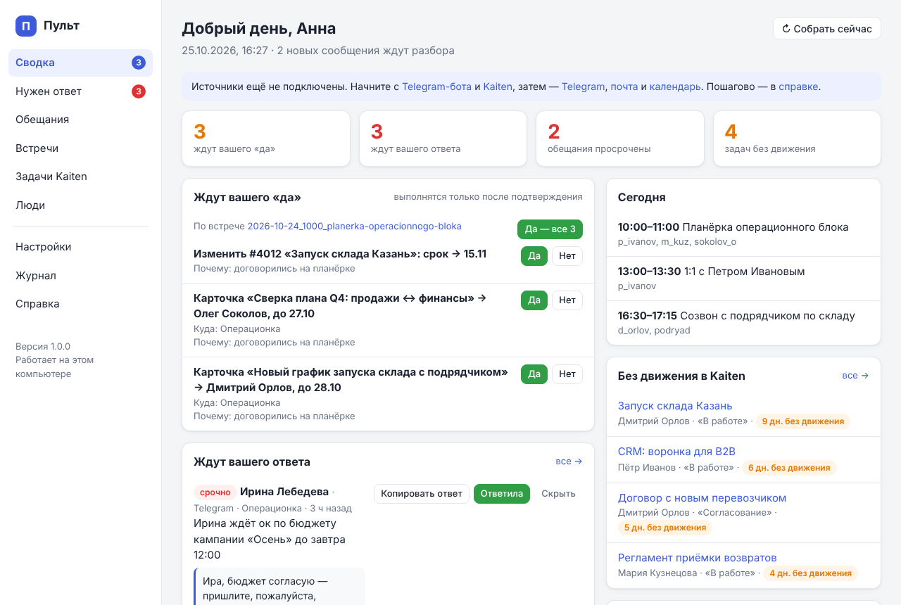
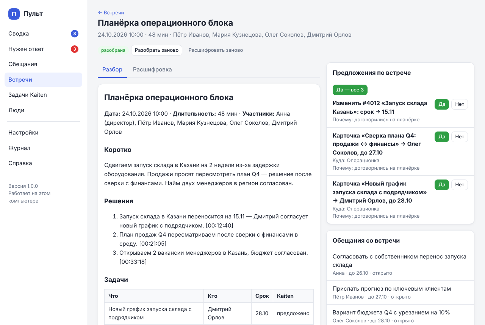

# Как пользоваться

## День с PULSE

**Утро (09:00)** — в Telegram приходит дайджест: встречи дня и что к ним подготовить,
кто ждёт вашего ответа, просроченные обещания (ваши и вам), зависшие задачи,
что ждёт вашего «да».

**После встречи** — запись попадает в папку (Телемост/Zoom) или вы отправляете её
боту. Через 15–40 минут бот присылает итог: главное, решения, задачи — и кнопки
«Да/Нет» для каждой предложенной карточки Kaiten. «Да — все» создаёт их одним нажатием.
Как выглядит итог — [пример разбора встречи](examples/разбор-встречи.md).

**В течение дня** — Claude каждые 2 часа разбирает новые сообщения. Срочное
(«нужен ваш ок до 12:00») приходит сразу, с готовым черновиком ответа.

**10:00** — напоминание о карточках без движения с кнопками «Напомнить»
(комментарий исполнителю в Kaiten) и «Отложить».

**Вечер (18:30)** — итоги дня и что осталось на завтра.

## Telegram-бот

| Команда | Что делает |
|---|---|
| `/today` | Сводка на сейчас (мгновенно, без ИИ) |
| `/approvals` | Что ждёт вашего «да» — с кнопками |
| `/promises` | Ваши обещания и обещания вам |
| `/inbox` | Где ждут вашего ответа — с черновиками |
| `/stale` | Задачи Kaiten без движения |
| `/meetings` | Последние встречи |
| `/digest` | Собрать дайджест с ИИ прямо сейчас |
| `/new` | Начать разговор с Claude заново |

**Просто пишите или говорите** — это вопрос к Claude:

- «Что мне обещал Петров на этой неделе?»
- «Что решили по складу в Казани?»
- «Кто ждёт от меня ответа?»
- «Поставь Ивановой задачу подготовить отчёт по возвратам к пятнице» → придёт
  предложение карточки с кнопкой «Да».
- «Запомни: я обещала Олегу посмотреть бюджет до среды».
- «Подготовь ответ Ирине про бюджет кампании» → готовый текст, который можно скопировать.

Голосовые расшифровываются на компьютере. Разговор помнит контекст 30 минут.

**Файл записи** (до 20 МБ) можно переслать боту — он расшифрует и разберёт.

## Админка (http://localhost:8765)

| Раздел | Что там |
|---|---|
| **Сводка** | Всё важное на одном экране: подтверждения, кто ждёт ответа, обещания, сегодня, зависшие задачи, лента бота, состояние источников |
| **Спросить Claude** | Разговор с Claude о ваших данных: встречах, задачах, переписке, документах. «Контекст» — приложить встречу (Claude прочитает расшифровку целиком), задачу, документ из папок или файл с компьютера; микрофон — диктовка: текст появляется по фразам, пока вы говорите (распознаёт Whisper на этом компьютере, ещё раз нажать или Esc — закончить). Ответ пишется у вас на глазах, таблицами, с отметками времени и источниками; чаты сохраняются — к любому можно вернуться и продолжить. Модель (Fable, Opus, Sonnet, Haiku) и глубину рассуждения выбирают у строки вопроса — новый чат начинается с выбора прошлого. Кнопка «Спросить Claude» есть и на странице встречи, в окне задачи и у документа |
| **Нужен ответ** | Сообщения, где ждут вашего решения, с черновиками («Копировать ответ», «Ответила», «Скрыть»); просмотр переписки по чатам |
| **Задачи** | Ваши задачи, что вам должны и договорённости между коллегами: доска, список и Гант. Новые задачи от Claude помечены «новая» (отметка снимается, когда вы наведёте на задачу или откроете её), кнопка «Новые» показывает только их. Сортировка — по сроку или «сначала новые». Подзадачи: если вы передали кому-то часть своей задачи, на карточке видно «Я + Пётр → Тимур». «В работе» — задача встаёт наверх колонки и подсвечивается зелёным. «В архив» — убрать задачу с доски, не закрывая; галочка «Показать архивные» покажет такие задачи серыми, с отметкой «архив». Встреча по задаче — метка со временем («завтра 15:00») на карточке: в окне задачи её выбирают из календаря или назначают («+ Назначить встречу»), а похожую встречу PULSE находит сам и спрашивает «Связать?» |
| **Календарь** | Встречи на неделю вперёд по дням и форма «Новая встреча» — создаёт встречу в календаре сразу, без отдельного подтверждения. Галочка ✓ на встрече — бриф готов: нажмите на встречу → «Открыть бриф» или «Копировать» |
| **Встречи** | Все встречи, загрузка записи, разбор и расшифровка с отметками времени. У задач в разборе — значок «задача →»: переход к задаче в «Задачах». Вкладка «Текст для отправки» — итоги для участников, готовые к копированию |
| **Дайджесты** | Утренние и вечерние дайджесты, итоги недели (по пятницам) и сводка рабочих групп Telegram |
| **Задачи Kaiten** | Зависшие карточки и все задачи отслеживаемых пространств с фильтрами |
| **Люди** | Справочник: один человек в Telegram, почте, Kaiten; загрузка — сколько у кого открытых задач и карточек Kaiten. Укажите @username в Telegram и рабочую почту — по ним работают напоминания и брифы |
| **Настройки** | Подключения и правила |
| **Журнал** | Что и когда делал PULSE, ошибки, ручной запуск заданий |
| **Справка** | Эта документация |

Если черновик ответа хорош — «Копировать ответ», вставьте в мессенджер, отправьте.
Ниже — «Напомните коллегам»: кому пора напомнить о задаче. Текст готов, его можно поправить;
«Отправить» отправит его из вашего Telegram (после вашего подтверждения).
Когда вы ответите в переписке, Claude при разборе прочитает ваш ответ и предложит убрать пункт:
«Похоже, вы уже ответили» с цитатой — «Да, убрать» или «Нет». Сообщение на другую тему ответом
не считается. Можно и сразу нажать «Ответила». Если пункт закрылся зря — «Вернуть» в «Недавно закрытых».

## Подтверждения

Всё, что меняет внешние системы (карточки, комментарии, сроки, встречи), сначала
попадает в очередь. Подтвердить можно кнопкой в боте, на Сводке, на странице
встречи — или сказать Claude в чате «да, создавай» (он спросит разрешение на запуск
команды). «Нет» просто убирает предложение.

Так же Claude предлагает закрыть задачу PULSE, если по встрече или переписке видно, что она
уже сделана: «Закрыть задачу «…» — похоже, выполнена», с доводом, цитатой и ссылками на задачу
и на встречу или сообщение. «Да» закрывает задачу, «Нет» оставляет в работе. То же предложение
видно в окне самой задачи. Чтобы Claude закрывал такие задачи сам, без вопроса, —
Настройки → Автономия.

## Разговор с Claude на компьютере

Откройте папку PULSE в Claude Code (приложение Claude → Code, или `claude` в
PowerShell или Терминале в папке PULSE) и спрашивайте как коллегу:

- «Что я обещала и не сделала?»
- «Собери всё, что было по проекту „Склад Казань“: встречи, переписка, задачи»
- «Какие задачи у Дмитрия зависли и что он говорил о них в чатах?»
- «Подготовь повестку завтрашней планёрки по открытым вопросам»
- «Найди в моих документах регламент возвратов и ответь Марии на её вопрос»
- «Разбери встречу заново и добавь задачу про отпуск Дмитрия»

Claude видит базу PULSE, встречи и папки с документами. Писать коллегам от вашего
имени он не может — только готовит черновики.

## Как улучшать качество

- **Справочник «Люди»**: добавьте ключевых сотрудников с их Telegram, почтой и
  пользователем Kaiten — так Claude точнее определяет исполнителей.
- **Неправильный разбор встречи**: поправьте `summary.md` руками или попросите Claude
  в чате; «Разобрать заново» — на странице встречи.
- **Расшифровка мешает работать**: «Пауза» — на странице встречи и в списке встреч; компьютер
  перестаёт её считать, «Продолжить» — с того же места. «Отменить» останавливает совсем,
  встреча остаётся. Не та запись — внизу страницы встречи «Удалить встречу целиком»: PULSE
  забудет её вместе с задачами, предложениями и записями базы знаний. «Удалить только запись»
  освобождает место на диске, а расшифровка и разбор остаются.
- **Лишние пункты «нужен ответ»**: «Скрыть» и скажите Claude в чате, что такие не
  нужны — он учтёт в этом разговоре; постоянные правила можно дописать в `CLAUDE.md`.
- **Шумный чат**: отключите его в Настройки → Telegram.
