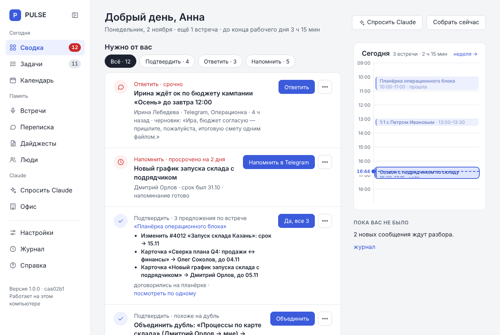
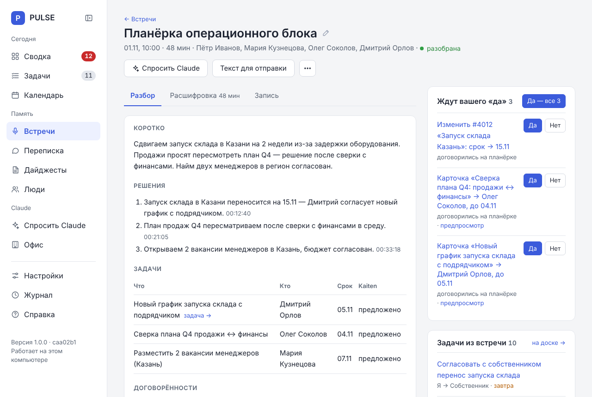

# Как пользоваться

## День с PULSE

**Утро (09:00)** — в Telegram приходит дайджест. Первая строка — реально ли успеть задачи между
встречами и три главных дела («Свободно 2 ч 10 мин, задач на 4 ч 30 мин — перегруз»). Дальше — встречи дня
и что к ним подготовить, кто ждёт вашего ответа, просроченные обещания (ваши и вам), зависшие задачи,
что ждёт вашего «да». Если день не помещается — «Разобрать день» на Сводке (см. ниже).

**После встречи** — запись попадает в папку (Телемост/Zoom) или вы отправляете её
боту. Через 15–40 минут бот присылает итог: главное, решения, задачи — и кнопки
«Да/Нет» для каждой предложенной карточки Kaiten. «Да — все» создаёт их одним нажатием.
Как выглядит итог — [пример разбора встречи](examples/разбор-встречи.md).

**В течение дня** — Claude каждые 2 часа разбирает новые сообщения. Срочное
(«нужен ваш ок до 12:00») приходит сразу, с готовым черновиком ответа.

**10:00** — напоминание о карточках без движения с кнопками «Напомнить»
(комментарий исполнителю в Kaiten) и «Отложить».

**Вечер (18:30)** — итоги дня и что осталось на завтра.

## Реальность дня: сколько времени на задачи есть

На Сводке над расписанием дня — **вердикт**: сколько свободного времени на задачи осталось сегодня, сколько
задач на сегодня и хватит ли одного на другое. Точка зелёная — **реально** (задач не больше 85% свободного
времени), оранжевая — **плотно** (до 110%), красная — **перегруз** с цифрой, на сколько. Полоса под ним —
то же наглядно: заливка — сколько нужно, чёрточка — сколько есть.

**Как считается свободное время.** Рабочие часы (Настройки → Основное) минус встречи всех календарей — Яндекса
и Google; встречи, которые идут одновременно, считаются одним занятым отрезком. После встречи с участниками
PULSE оставляет 10 минут на хвосты, перед встречей с готовым брифом — 10 минут его прочитать (на расписании —
тонкая штриховка). Окна короче 25 минут показаны серым и в свободное время не входят: в них ничего толком не
сделать. Сегодня время считается от текущего момента. Встречи, от которых вы отказались, и события с пометкой
«свободен» время не занимают.

**«Тайм-аут» — время для задач.** Если вы ставите себе в календарь время на работу («тайм-аут», «фокус»,
«работа с задачами» — без других участников), PULSE считает его не встречей, а лучшим окном: задачи ставятся
туда в первую очередь. На расписании такой блок зелёный. Свои названия — в Настройки → День.

**Что считается задачами на сегодня.** Только ваши задачи: просроченные, со сроком сегодня, все «в работе» и те,
что нужны в ближайшие два рабочих дня, если их ждут другие («ждут Пётр, Мария»). Плюс «нужен ответ» — по 5 минут
на каждый. Что вам должны и договорённости коллег — чужая работа, в ваш день не входят. Задачи, которые сами
чего-то ждут, в план не ставятся — они перечислены отдельно (о «мяче на чужой стороне» — ниже).

**Оценки.** Сколько задача займёт у вас (не у всего проекта) — в окне задачи: «Займёт у вас: 15м · 30м · 1ч ·
2ч · полдня». Claude ставит оценку сам, когда записывает задачу; ваш выбор он больше не меняет. Пока оценки нет,
PULSE считает 30 минут («оценка по умолчанию»).

**План на расписании.** В свободных окнах — пунктирные блоки задач: в порядке приоритета (просроченное → срок
сегодня → кого ждут другие → «в работе» → остальное), каждая в первое окно, где хватает места. Зелёный блок с пунктиром — задача «в работе», серый — остальные.
Задачи на 15 минут PULSE ставит подряд, пачками до часа, и рисует одним блоком **«Мелочи ×3: название · название ·
название»** — их удобнее сделать разом. Щелчок по блоку открывает **меню**: «Готово», «Моя часть готова…», «Не в этот
день», «Отменить ваше решение» и «Займёт: 15м · 30м · 1ч · 2ч»; у пачки — список мелочей с «готово» у каждой. Задачу
целиком — щелчок по её названию в меню. Блок можно **перетащить** на другое время: задача закрепится там (рамка станет
сплошной), и PULSE расставит остальное вокруг неё; пачка переезжает целиком. Нижний край блока — «сколько займёт»:
потяните его, шаг 15 минут. Под вердиктом — «Сейчас: окно до 15:15 (40 мин) — подходит «…»» или «Следующее
окно …». Если задача длиннее самого длинного окна, PULSE так и пишет — её лучше разбить на части, передать или
поручить агенту.
Сделанное из плана остаётся на расписании галочкой, под вердиктом — «План дня: сделано 3 из 5».

**«Разобрать день».** Кнопка над расписанием (при «плотно» и «перегрузе» — синяя) открывает все задачи на сегодня:
сколько займёт, почему сегодня, предложенное время. Решения:

- **В план** — в выбранное окно (или «авто» — куда поместится). Так можно взять в сегодняшний план и задачу
  с более поздним сроком. «Отменить решение» — пусть PULSE расставляет сам;
- **Завтра** (в пятницу — «В понедельник») — срок на следующий рабочий день, задача уходит из сегодняшнего плана;
- **Свой срок** — те же быстрые сроки, что в «Уточнить срок», или своя дата;
- **Снять срок** — задача остаётся без срока и уходит из плана на сегодня;
- **Передать** — кому, что и к какому сроку: часть работы уходит коллеге подзадачей (на доске — «Я + Пётр →
  Тимур»). Задача остаётся вашей и ждёт эту часть — из плана на сегодня она уходит, а когда часть готова, возвращается;
- **Агенту** — «Поручить агенту» поверх окна разбора: PULSE соберёт промт для Claude Code или Codex по этой задаче;
- чипы оценки — поправить, сколько займёт.

Каждое решение сохраняется сразу, итог сверху пересчитывается: «После ваших решений: задач на 2 ч 05 мин из
2 ч 10 мин свободных — реально». «Готово» закрывает окно и обновляет Сводку. Ваши решения PULSE не двигает.
План живёт только в PULSE — в Яндекс и Google Календарь ничего не пишется.

**Вечер.** Когда рабочий день закончился, под вердиктом — что из сегодняшнего не закрыто (срок сегодня или раньше,
или вы сами ставили в план) и кнопка «Перенести незакрытое на завтра» (в пятницу — «на понедельник»); у каждой
задачи — своя ссылка «на завтра». Если срок задачи и так позже, он не меняется — задача просто будет в плане завтра.
В вечернем дайджесте — «План дня: сделано N из M».

**Уведомления в углу экрана.** «Задача «…» на сегодня: места нет — что двигаем?» — если в перегруженный день Claude
записал вам новую задачу со сроком сегодня; «Календарь изменился: …» — если встреча сдвинулась или добавилась и от
этого поменялся вердикт. Нажатие открывает «Разобрать день».

**Неделя.** По понедельникам под вердиктом дня и в утреннем дайджесте — «На неделю: окон 9 ч, задач 14 ч — перегруз
с четверга». PULSE складывает по дням окна и задачи со сроком на этой неделе нарастающим итогом (задачу со сроком
в четверг можно делать с понедельника) и называет первый день, к которому задач больше, чем окон. В другие дни
строка видна, только если впереди перегруз; наведите на неё — окна и задачи по дням. Если перегружен только
сегодняшний день, а дальше всё помещается, — «реально (сегодня — перегруз)». Claude видит неделю командой
`./ops day week`.

**Срок в момент обещания.** Когда Claude записывает вам задачу со сроком, PULSE сразу проверяет: хватит ли ваших окон
до этого срока с учётом задач, которые уже на него и раньше. Не хватает — в разборе встречи у задачи пометка «срок
под угрозой с самого начала — реальнее ДД.ММ», а в «Уточнить срок» на Сводке эта задача появляется с объяснением
и первой кнопкой «Реальнее» — с ближайшей датой, к которой успеть реально. «Оставить ДД.ММ» — срок остаётся, и PULSE
о нём больше не спрашивает. Сам срок PULSE не меняет. Проверить срок до того, как пообещать: спросите Claude
«успею к пятнице?» — он посмотрит `./ops day capacity`.

**Задачи в Календаре.** Чтобы видеть загрузку на дни вперёд, PULSE расписывает ваши задачи по свободным окнам Календаря:
«в работе» — первыми, остальные — по сроку, каждая не позже своего срока; сегодня — ровно как на Сводке. Задачи без
срока и не «в работе» не расписываются. Цвета одни и те же на Сводке и в Календаре: светло-зелёный блок с зелёным
пунктиром — задача «в работе», серый с пунктиром — остальные запланированные, сплошная рамка — вы поставили её сами,
оранжевая рамка — встанет уже после срока. Если задача не влезает до своего срока, в строке «весь день» дня срока —
оранжевая плашка «не влезает до срока». В «Месяце» у дня — «задачи: 3 · 2 ч» (зелёная точка — есть задачи «в работе»),
щелчок — неделя с этим днём; в «Списке» — задачи под встречами своего дня. Кнопка «Задачи» рядом с видами показывает
и прячет их, выбор запоминается. Щелчок по задаче — то же меню, что на Сводке. **Перетащите блок в другой день недели** —
задача встанет туда на это время, и раньше этого дня PULSE её не поставит (в прошедшие дни переносить нельзя, в выходной —
можно; если это позже срока, рамка оранжевая). «Не в этот день» в меню — задача уйдёт в следующее окно. Если вы убрали из
сегодняшнего плана задачу со сроком сегодня, в строке «весь день» — «вы убрали из плана — срок ДД.ММ». План живёт
только в PULSE — в Яндекс и Google Календарь задачи не пишутся.

**Мяч на чужой стороне.** Бывает, что своя часть задачи сделана, а дальше — коллега: вы отправили MR на ревью, договор
на согласование, попросили данные. Делать в задаче вам пока нечего, и в план она не ставится — даже «в работе». Как
это попадает в PULSE:

- **Кнопка «Моя часть готова…»** в окне задачи: кто дальше, что он должен сделать и, если знаете, к какому сроку. Его
  часть становится задачей «вам должны» и подзадачей вашей (на доске — «Я + Пётр → Тимур»), с обычными напоминаниями;
- **Claude сам** — если в переписке видно, что вы передали следующий шаг (ваше сообщение «отправил MR», «скинул договор
  на согласование»). Обещания коллеги он не ждёт;
- **вопрос без ответа** — если последнее в ходе задачи «спросили, ждём ответа», задача тоже не в плане, пока не придёт
  ответ.

Такие задачи перечислены в «Разобрать день» в строке «Ждут других» («передано: Пётр Иванов», «ответа нет 2 дня»),
а в Календаре — плашкой с песочными часами в строке «весь день» в день срока: время они не занимают, но и не
теряются. Срок прошёл — плашка оранжевая. Больше двух в день — одной плашкой «Ждут других: N», список по щелчку.
Когда коллега закрыл свою часть, в углу экрана — «Мяч снова у вас», задача возвращается в план, а в её окне PULSE
спрашивает «Что осталось сделать вам?» — оценкой (обычно после ревью это 15 минут, а не исходный час), «Как было» или
«Ничего — задача готова».

**Итоги недели** (пятница) теперь говорят и про приток задач: сколько ваших задач добавилось и закрыто, вырос ли
долг и сколько в среднем даёт вам одна встреча, — и сколько окон и задач на следующей неделе.

**Настройки → День:** названия фокус-блоков, минуты после встречи и перед встречей с брифом, самое короткое
рабочее окно, обед (по желанию), минуты на каждый «нужен ответ».

Спросить можно и в боте: «сколько у меня сегодня времени на задачи?», «что не успеваю?». Claude смотрит то же
самое командой `./ops day`.

## Telegram-бот

| Команда | Что делает |
|---|---|
| `/today` | Сводка на сейчас (мгновенно, без ИИ) |
| `/approvals` | Что ждёт вашего «да» — с кнопками |
| `/promises` | Ваши обещания и обещания вам |
| `/inbox` | Где ждут вашего ответа — с черновиками |
| `/stale` | Задачи Kaiten без движения |
| `/meetings` | Последние встречи |
| `/digest` | Собрать дайджест с ИИ прямо сейчас |
| `/new` | Начать разговор с Claude заново |

**Просто пишите или говорите** — это вопрос к Claude:

- «Что мне обещал Петров на этой неделе?»
- «Что решили по складу в Казани?»
- «Кто ждёт от меня ответа?»
- «Поставь Ивановой задачу подготовить отчёт по возвратам к пятнице» → придёт
  предложение карточки с кнопкой «Создать карточку».
- «Запомни: я обещала Олегу посмотреть бюджет до среды».
- «Подготовь ответ Ирине про бюджет кампании» → готовый текст, который можно скопировать.

Голосовые расшифровываются на компьютере. Разговор помнит контекст 30 минут.

**Файл записи** (до 20 МБ) можно переслать боту — он расшифрует и разберёт.

## Админка (http://localhost:8765)

| Раздел | Что там |
|---|---|
| **Сводка** | Всё важное на одном экране: подтверждения, кто ждёт ответа, обещания, сегодня, зависшие задачи, лента бота, состояние источников. Внизу ленты «Нужно от вас» — «Уточнить срок»: ваши задачи без срока и что вам должны без срока (договорённости между коллегами сюда не попадают), а также ваши задачи, чей срок под угрозой с самого начала (первая кнопка — «Реальнее», «Оставить ДД.ММ» — срок остаётся). «Разобрать» показывает их по одной: «Завтра», «Послезавтра», «До конца недели», «До конца месяца» или своя дата → «Сохранить срок»; «Оставить без срока» — PULSE больше не спросит о задаче; «Не сейчас» — к следующей. Строка «Напомнить» — коллеге, у которого срок сегодня, завтра или уже прошёл: готовый текст, «Копировать», «↗ Telegram», «Отправить»; в «…» — «Уже напомнили» (строка уйдёт до завтра), «Не напоминать 3 дня», «Больше не напоминать» (до нового срока; вернуть — «Снова напоминать» в окне задачи) |
| **Угол экрана** | На любой странице справа внизу — что PULSE делает сейчас («Разбор сообщений (Claude) — 115 новых») и что сделал: разобрал сообщения (сколько и что нашёл), расшифровал и разобрал встречу, отправил дайджест, ответил в «Спросить Claude», не смог собрать сообщения. Нажатие на уведомление ведёт туда, где результат, и скрывает его; после разбора сообщений — в «Задачи» (новые) или «Нужен ответ», смотря где прибавилось больше. ✕ — скрыть одно, «Скрыть все» справа над уведомлениями — все; видно три последних, остальные — «Ещё N», за последние сутки |
| **Спросить Claude** | Разговор с Claude о ваших данных: встречах, задачах, переписке, документах. «Контекст» — приложить встречу (Claude прочитает расшифровку целиком), задачу, документ из папок или файл с компьютера; микрофон — диктовка: текст появляется по фразам, пока вы говорите (распознаёт Whisper на этом компьютере, ещё раз нажать или Esc — закончить). Ответ пишется у вас на глазах, таблицами, с отметками времени и источниками; чаты сохраняются — к любому можно вернуться и продолжить. Модель (Fable, Opus, Sonnet, Haiku) и глубину рассуждения выбирают у строки вопроса — новый чат начинается с выбора прошлого. Кнопка «Спросить Claude» есть и на странице встречи, в окне задачи и у документа |
| **Офис** | Сверху — один большой офис картинкой: у PULSE и у каждой вашей папки с Claude Code (Настройки → Офис) свой open space со своей вывеской и ковролином, проекты папки — цветные коврики (названия проектов — в списках под картинкой, над столами — только названия сессий); спереди общий лаунж: кухня с кофемашиной, диваны, переговорный стол, кулер, кресла-мешки, по коридору ходит кот. Кто работает — сидит за своим столом и печатает, рядом реплика, что он делает («Ищет в переписке: склад»); кто ждёт вашего ответа — встал у стола и машет (для сессий из приложения Claude — только если Claude действительно нужно ваше действие и вы ещё не открывали сессию после ответа; что нужно — в карточке); свободные сотрудники PULSE отдыхают в лаунже или сидят у себя и время от времени переходят с места на место; неактивные сессии папок сидят у своих столов полупрозрачными, приглушены и проекты, где никто не работает. Бейдж над головой — имя и точка состояния (зелёная — работает, оранжевая — ждёт ответа, красная — ошибка); субагенты — роботы-помощники у стола. Офис двигают мышью (зажать и тянуть), подведя курсор к краю или стрелками; «+»/«−» и щипок на трекпаде — ближе и дальше, «⤢» — весь офис. Нажатие на сотрудника или его стол открывает его карточку справа, «В списке ↓» — к ней в списке. На картинке — сессии за последние сутки и все, кто работает или ждёт ответа (не больше 4 столов на проект и 16 на папку); остальные — в списке. Днём в окнах небо, вечером — ночь и звёзды, часы на стене идут. Анимация работает, только пока страница на экране; «Скрыть картинку» — оставить одни списки. Под картинкой — по спойлеру на офис (раскрытые запоминаются). В спойлере PULSE рабочие места: секретарь (разбор сообщений), стенографист (встречи), машинистка (расшифровка), референт (брифы), редактор (дайджесты), архивариус (база знаний), дежурный (бот), собеседник («Спросить Claude») и курьер (сбор сообщений, Kaiten, календаря) — что делает сейчас по шагам, последний итог со ссылкой, когда возьмётся снова, история с шагами. Строка «Сейчас» в углу экрана ведёт сюда. В спойлере папки — её сессии Claude Code по проектам: кто работает и кто ждёт ответа, субагенты с их задачами, сделанные файлы (открываются по нажатию) и кнопка «Открыть в Claude» — приложение Claude откроется сразу на этой сессии (для сессий, начатых в приложении). Можно добавить и папку, внутри которой лежит сам PULSE: его фоновые запуски в офис папки не попадают. Списки обновляются сами |
| **Нужен ответ** | Сообщения, где ждут вашего решения, с черновиками («Копировать ответ», «Ответила», «Скрыть»); просмотр переписки по чатам |
| **Задачи** | Ваши задачи, что вам должны и договорённости между коллегами: доска, список и Гант. Договорённости между коллегами PULSE собирает и закрывает сам, поэтому по умолчанию они скрыты: галочка «Показать: Между коллегами» под заголовком возвращает их на доску, в список и на Гант (при поиске и фильтре по человеку или проекту они видны и так). Рядом — «Готово»: задачи, закрытые за две недели. «Кратко / Подробно» — вид карточек на доске: подробно сразу видно, что сейчас по задаче, чего она ждёт, откуда она, проект и пункты. Галочки и вид запоминаются. Новые задачи от Claude помечены синей точкой перед названием (отметка снимается, когда вы задержите на задаче курсор или откроете её), кнопка «Новые» под заголовком показывает только их. Кнопка «Без срока» рядом — только задачи без срока; там же «Разобрать сроки по одной» — то же окно, что на Сводке. Сортировка — по сроку или «сначала новые». Задачи со сроком больше чем через две недели — в самом низу каждого блока под пунктирной плашкой «Ещё N задач со сроком после ДД.ММ»: щелчок показывает их, второй — прячет (в поиске и при фильтре «Срок» видно всё сразу). Подзадачи: если вы передали кому-то часть своей задачи, на карточке видно «Я + Пётр → Тимур». «Ждёт»: задачу не закончить, пока не сделана другая или не случилось событие («Схемы в карточку проекта» ждёт «Описание процесса подрядчику», «Бюджет склада» — встречу Олега с собственником) — в окне задачи «Связать с другой задачей» → «Ждёт». На карточке — метка «ждёт», в блоке связей — чего она ждёт и кто ждёт её, «срок под угрозой», если то, чего ждём, просрочено или придёт позже срока. Когда готово всё, чего ждали, в углу экрана появится «Можно делать: …». Пункты — большую задачу можно разбить на части («Схемы процессов склада»: приёмка, хранение, отгрузка…): в окне задачи «Пункты» — добавить через «;», отметить готовые галочкой; на карточке — полоска «6 из 9». На Ганте стрелки показывают «ждёт»: от задачи, которую ждут, к той, что ждёт; наведите на полосу — её стрелки подсветятся. Kaiten: если у обеих задач есть карточки, в окне задачи у связи «ждёт» — кнопка «Заблокировать в Kaiten» (карточка станет «Заблокировано» со ссылкой), а блокировки, поставленные в самом Kaiten, PULSE подтягивает в «ждёт» с пометкой «из Kaiten» и снимает, когда их снимают там. Проекты — вид «Проекты» рядом с Гантом: задачи с общим результатом («Запуск склада в Казани»), у каждого проекта — процент выполненного (задача с пунктами идёт долей готовых пунктов), на ком он стоит и сколько задач ждут других. Внутри проекта — задачи по шагам: «Можно делать сейчас», дальше то, что ждёт предыдущее, внизу — выполненное. Задачу добавляют в проект на его странице, полем «Проект» в окне задачи или при создании; подзадачи идут за основной сами. Фильтр «Проект» на доске, в списке и на Ганте показывает только его задачи. «Собрать проекты с Claude» — Claude предложит проекты, связи и объединение дублей по вашим задачам, встречам и переписке (и делает это сам по понедельникам). Дубль — в окне задачи «Это дубль задачи…» → «Объединить»: задача закроется, а её источник, связи и подзадачи перейдут в основную; «Вернуть» сделает её снова самостоятельной. «В работе» — задача встаёт наверх колонки и подсвечивается зелёным. «В архив» — убрать задачу с доски, не закрывая; галочка «Показать архивные» покажет такие задачи серыми, с отметкой «архив». Встреча по задаче — метка со временем («завтра 15:00») на карточке: в окне задачи её выбирают из календаря или назначают («+ Назначить встречу»), а похожую встречу PULSE находит сам и спрашивает «Связать?» |
| **Календарь** | Встречи на неделю вперёд по дням и форма «Новая встреча» — создаёт встречу в календаре сразу, без отдельного подтверждения. Галочка ✓ на встрече — бриф готов: нажмите на встречу → «Открыть бриф» или «Копировать» |
| **Встречи** | Все встречи, загрузка записи, разбор и расшифровка с отметками времени. У задач в разборе — значок «задача →»: переход к задаче в «Задачах». Вкладка «Текст для отправки» — итоги для участников, готовые к копированию |
| **Дайджесты** | Утренние и вечерние дайджесты, итоги недели (по пятницам) и сводка рабочих групп Telegram |
| **Задачи Kaiten** | Зависшие карточки и все задачи отслеживаемых пространств с фильтрами |
| **Люди** | Справочник: один человек в Telegram, почте, Kaiten; загрузка — сколько у кого открытых задач и карточек Kaiten. Укажите @username в Telegram и рабочую почту — по ним работают напоминания и брифы |
| **Настройки** | Подключения и правила |
| **Журнал** | Что и когда делал PULSE, ошибки, ручной запуск заданий |
| **Справка** | Эта документация |

Если черновик ответа хорош — «Копировать ответ», вставьте в мессенджер, отправьте.
Ниже — «Напомните коллегам»: кому пора напомнить о задаче. Текст готов, его можно поправить;
«Отправить» отправит его из вашего Telegram (после вашего подтверждения).
Когда вы ответите в переписке, Claude при разборе прочитает ваш ответ и предложит убрать пункт:
«Похоже, вы уже ответили» с цитатой — «Да, убрать» или «Нет». Сообщение на другую тему ответом
не считается. Можно и сразу нажать «Ответила». Если пункт закрылся зря — «Вернуть» в «Недавно закрытых».

## Подтверждения

Всё, что меняет внешние системы (карточки, комментарии, сроки, встречи), сначала
попадает в очередь. Подтвердить можно кнопкой в боте, на Сводке, на странице
встречи — или сказать Claude в чате «да, создавай» (он спросит разрешение на запуск
команды). На кнопке написано, что произойдёт: «Создать карточку», «Закрыть задачу»,
«Связать со встречей», «Напомнить», «Объединить». «Нет» просто убирает предложение.

Так же Claude предлагает закрыть задачу PULSE, если по встрече или переписке видно, что она
уже сделана: «Закрыть задачу «…» — похоже, выполнена», с доводом, цитатой и ссылками на задачу
и на встречу или сообщение. «Закрыть задачу» закрывает её, «Нет» оставляет в работе. То же предложение
видно в окне самой задачи. Чтобы Claude закрывал такие задачи сам, без вопроса, —
Настройки → Автономия.

Связи между задачами Claude ставит сам, только если они прозвучали прямо («как будет готово — кидай»,
«без вашей папки не отдам») — в окне задачи у такой связи пометка «поставил Claude», убрать — ✕.
Если зависимость понятна лишь по смыслу, он спросит: «Задача «…» ждёт «…»?». Две задачи об одном
и том же («Процессы по карте склада» и «Схемы процессов склада») он тоже не объединяет сам,
а предлагает: «Объединить дубль: … → …» — кнопки в окне задачи и на Сводке. Так же и проекты:
по понедельникам (Настройки → Расписание) и по кнопке «Собрать проекты с Claude» он предлагает собрать
задачи в проект — «Проект «…»: 9 задач» со списком задач и доводом; «Создать проект» — проект появится в «Задачи → Проекты».
В уже созданный проект Claude добавляет новые задачи сам, когда разбирает встречи и переписку по этому делу.

## Ход задачи: статус обновляется сам

Чтобы понять, где задача, не нужно собирать статус по чатам: PULSE ведёт её ход. В окне задачи справа — лента
«Ход задачи» (на узком экране — под задачей), от появления до последнего апдейта:

- **Из переписки и встреч — сам Claude.** Разбирая сообщения в Telegram, Пачке, Я.Мессенджере и почте и разбирая
  встречи, он дописывает шаги по открытым задачам: вы спросили Петра, кто поможет с договором поставщика; Пётр ответил,
  что этим занимался Олег; вы спросили, когда Олег вернётся; Олег в Telegram — «вернусь в среду, до 16-го подпишу
  договор и согласую цены». У каждой записи — откуда она (чат или встреча), когда и ↗ к самому сообщению.
  Личное (здоровье, семья) Claude не пересказывает. Новое появляется при очередном разборе сообщений (по умолчанию —
  раз в два часа в рабочее время или сразу, как накопится 50 новых; Настройки → Расписание) и после разбора каждой
  встречи. Дописал — в углу экрана «Обновил ход задачи «…»» с новым статусом, щелчок открывает задачу; по нескольким
  задачам — «Обновил ход задач: 3» и какие.
- **События — PULSE.** Перенесли срок («Срок: 30.11 → 16.11»), взяли в работу, задача стала ждать другую или
  событие и дождалась, готов пункт, напомнили исполнителю, объединили с дублем, карточка Kaiten перешла в другую
  колонку — серой строкой в той же ленте.
- **Ваш комментарий** — поле внизу ленты и «Записать» (или ⌘/Ctrl + Enter). Галочка «жду ответа» — если вы
  кого-то спросили: пока не появится новая запись, у задачи будет «ответа нет N дней». Справа у каждой записи —
  карандаш (поправить текст прямо в ленте) и корзина (удалить, PULSE переспросит). Боту можно сказать «запиши
  в задачу про упаковку: звонил Олегу» — он сделает то же.

Последняя запись — строка **«Сейчас»** под заголовком окна задачи: «Олег вернётся 11.11, до 16.11 подпишет
договор · 05.11 · Telegram». Вопрос без ответа подсвечен оранжевым: «Спросили Петра, когда вернётся Олег — ответа нет
2 дня». Та же строка — на раскрытой карточке доски и в «Списке» под названием, а «без ответа 2 дн.» — прямо на карточке.

**«Собрать с Claude»** над лентой (или «Собрать с ChatGPT», если в настройках выбран он) — для задач, которые
появились раньше, или если что-то прошло мимо: помощник поищет
по задаче в переписке, встречах и Kaiten и допишет пропущенные шаги. Пока он работает (минута-две), в ленте бегут
точки и видно, что он делает сейчас («Ищет в переписке: …»); закончил — новые записи появляются сами, внизу
«Готово — добавлено записей: N», в углу экрана — «Собрал ход задачи». Повторный сбор не дублирует то, что уже записано.

Ход задачи Claude учитывает везде: в ответах на «что с задачей?» в боте и в «Спросить Claude», в дайджестах
(«Договор упаковки — Олег вернётся 11.11»), в брифах к встречам и в промтах для агентов.

## Поручить задачу агенту

Часть задач удобнее отдать агенту — новой сессии Claude Code (или Codex) в папке проекта: сводку, таблицу, расчёт,
черновик регламента. Промт для него PULSE собирает сам.

1. Откройте задачу → **«Поручить агенту»** (у задач, похожих на работу для агента, кнопка подсвечена).
2. **Где работать** — папка или проект из Настройки → Офис; по умолчанию — там, где вы делали похожие задачи.
   **Кто** — Claude или Codex.
3. **«Собрать промт».** Claude за 30–90 секунд соберёт подробную постановку: что нужно получить и к какому сроку,
   откуда задача (цитата из встречи со временем, сообщение), решения, которые нельзя нарушать, нужные файлы с причиной,
   как похожее уже делали в ваших прошлых сессиях и что тогда пришлось уточнять, вопросы на случай, если что-то неясно.
4. Проверьте промт: текст правится прямо в окне (сохраняется сам), лишний файл — снимите галочку, строка уйдёт из промта.
   Нужно иначе — впишите в «Что поправить» («добавь про прогноз Q4», «без расчёта маржи») → «Пересобрать».
5. **«Открыть в Claude»** — приложение Claude откроет новую сессию в выбранной папке с промтом в поле ввода.
   Ещё раз посмотрите и нажмите Enter — отправляете вы. **«Копировать промт»** — отнести промт агенту самой
   (так — для Codex: открыть его сразу из PULSE можно будет в следующей версии).

Под промтом — **похожие поручения**: прошлые сессии, сколько реплик понадобилось, что получилось и что пришлось
уточнять; «Открыть в Claude» у сессии откроет её в приложении. Полный текст каждого промта лежит в `data/agent-briefs/`.
Длинный промт уходит в Claude файлом: в поле ввода — короткое поручение с путём к нему.

**Когда агент работает.** Отправленная сессия в течение минуты появляется в окне задачи блоком «Агент»: работает,
ждёт вашего ответа (и что нужно), ждёт разрешения или готово; там же «Открыть в Claude» и файлы, которые агент
создал, — «Открыть» и «Показать в Finder». На карточке задачи на доске и в списке — метка с роботом. PULSE узнаёт
сессию по строке «PULSE: задача #…» в первом сообщении — не стирайте её из промта. Когда приложение Claude отметит
сессию готовой, PULSE предложит «Закрыть задачу «…» — агент сделал: …» — кнопка в окне задачи и на Сводке.
В «Офисе» у такой сессии пометка «По задаче «…»». Куда поручать по умолчанию — Настройки → Офис → «Папка
по умолчанию для поручений агенту».

**Codex.** «Кто → Codex» — промт пишется для Codex, а «Открыть в Codex» откроет новый тред в приложении ChatGPT
в папке поручения с промтом в поле ввода (отправляете вы; папку ChatGPT добавит в свои проекты). Без приложения
ChatGPT откроется Терминал с Codex CLI в этой папке, промт — в буфере обмена: вставьте и нажмите Enter.

**Пометка «Можно поручить агенту».** Разбирая встречи и переписку, Claude отмечает ваши задачи, которые удобно отдать
агенту, и пишет, что агент сделает. В окне задачи — «Можно поручить агенту: …» и «Собрать промт», на карточке —
метка «агенту?». Агента Claude сам не запускает.

Опыт агентов PULSE берёт из журналов Claude Code и Codex в папках «Офиса» — только читает их, раз в час, и помнит
сессии полгода. Что вы дописывали агенту после первого промта, Claude учитывает в новых промтах, а промты, после
которых агенту хватило одной-двух реплик, служат образцами. Скрытые проекты (Настройки → Офис), секреты и фоновые
запуски самого PULSE в промты не попадают.

## Разговор с Claude на компьютере

Откройте папку PULSE в Claude Code (приложение Claude → Code, или `claude` в
PowerShell или Терминале в папке PULSE) и спрашивайте как коллегу:

- «Что я обещала и не сделала?»
- «Собери всё, что было по проекту „Склад Казань“: встречи, переписка, задачи»
- «Какие задачи у Дмитрия зависли и что он говорил о них в чатах?»
- «Подготовь повестку завтрашней планёрки по открытым вопросам»
- «Найди в моих документах регламент возвратов и ответь Марии на её вопрос»
- «Разбери встречу заново и добавь задачу про отпуск Дмитрия»

Claude видит базу PULSE, встречи и папки с документами. Писать коллегам от вашего
имени он не может — только готовит черновики.

## Как улучшать качество

- **Справочник «Люди»**: добавьте ключевых сотрудников с их Telegram, почтой и
  пользователем Kaiten — так Claude точнее определяет исполнителей.
- **Неправильный разбор встречи**: поправьте `summary.md` руками или попросите Claude
  в чате; «Разобрать заново» — на странице встречи.
- **Расшифровка мешает работать**: «Пауза» — на странице встречи и в списке встреч; компьютер
  перестаёт её считать, «Продолжить» — с того же места. «Отменить» останавливает совсем,
  встреча остаётся. Не та запись — внизу страницы встречи «Удалить встречу целиком»: PULSE
  забудет её вместе с задачами, предложениями и записями базы знаний. «Удалить только запись»
  освобождает место на диске, а расшифровка и разбор остаются.
- **Лишние пункты «нужен ответ»**: «Скрыть» и скажите Claude в чате, что такие не
  нужны — он учтёт в этом разговоре; постоянные правила можно дописать в `CLAUDE.md`.
- **Шумный чат**: отключите его в Настройки → Telegram.
